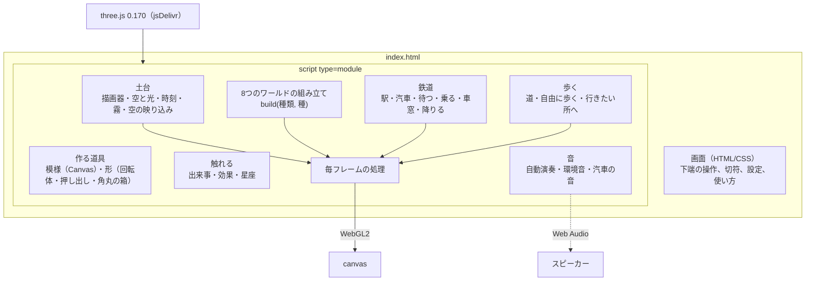
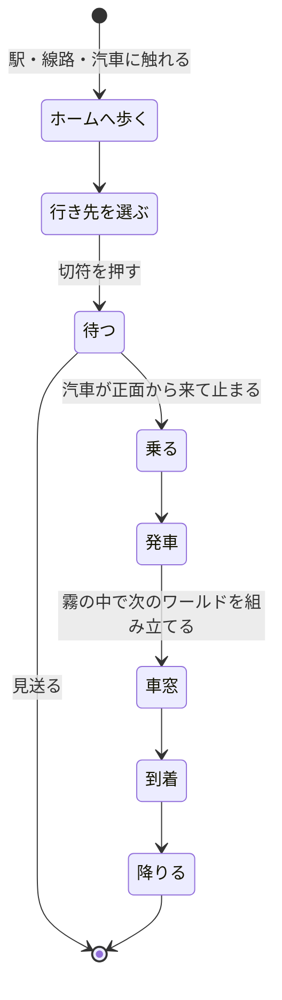

# まぼろし線 のしくみ

まぼろし線の作り方を、コードを読む人向けにまとめた文書です。
見た目のきまりは [DESIGN.md](DESIGN.md) にあります。

## 1. 全体像

- **ファイルは `index.html` の1つだけ**です（約50万字・約3,500行）。ビルドも依存パッケージのインストールも要りません。
- 3D は [three.js](https://threejs.org/) 0.170 を、`importmap` で jsDelivr から読み込みます。ほかのライブラリは使っていません。
- **画像・3Dモデル・音声のファイルは一つも使っていません。** 地形、建物、生き物、模様（テクスチャ）、音楽、効果音は、すべて実行時にコードで作ります。
- 置いてあるほかのファイルは、共有用の画像（`og.jpg`）、ホーム画面用のアイコン、`manifest.webmanifest`、README の画像（`docs/`）だけです。
- 公開は Vercel です。GitHub の `main` に push すると自動で配信されます（静的ファイルの配信だけで、サーバー側の処理はありません）。

## 2. ファイルの中の並び

`index.html` は次の順に書かれています。区切りごとに日本語の見出しコメント（`/* ---------- 〇〇 ---------- */`）が付いています。

| 順 | 区切り | 中身 |
|---|---|---|
| 1 | head / CSS | 画面の配置、下端の操作列、切符、設定、待機の画面 |
| 2 | HTML | canvas、操作ボタン、切符の束、設定、使い方、失敗したときの表示 |
| 3 | 土台 | 描画器の用意、旧来の色計算を保つ補正、時刻から空の色と光を決める処理 |
| 4 | 共通の素材 | 継ぎ目のないノイズ、地面・煉瓦・石・木・毛皮・鱗などの模様を Canvas で描く |
| 5 | 生き物と植物の素材 | 魚・鯉・くらげ・茸・珊瑚などの形と模様 |
| 6 | ワールドの組み立て | 港町、宇宙の砂漠、海底都市、雪原の駅、雲海の浮島、光る森、鏡の塩原、硝子の温室 |
| 7 | 音 | 世界ごとの音階・音色・環境音、出来事の音、汽車の音 |
| 8 | 進行 | ワールドの切り替え、毎フレームの処理、触れたときの応え、歩く人 |
| 9 | 待機・記録・設定 | 額縁／ちらっと見る／音だけ、お気に入りと履歴、書き出し |
| 10 | 鉄道 | 汽車の形、駅、線路沿いの整地、旅の流れ、客車の中、切符 |
| 11 | ガイド・使い方 | 最初の案内、ヒント |
| 12 | 点検画面 | URL に `?dev` を付けたときだけ動く開発用の画面 |

## 3. 描画の土台

- **描画器**: `WebGLRenderer`。影は `PCFSoftShadowMap`。解像度は端末の倍率と 2 の小さいほう。
- **旧来の色の扱いを保つ補正**: 古い three.js で色を決めたため、0.170 でも同じ明るさ・色になるよう、色管理を切り、光の減衰と明るさの計算（シェーダーの一部）を古い式に差し替えています。
- **時刻**: 端末の時刻（または設定で選んだ時刻）から、空の色・太陽と月の向き・光の強さを毎フレーム決めます。空を見上げて上下になぞると時刻が動きます。
- **空の映り込み**: 霧の色と空の色、太陽・月の向きから小さな空の絵を作り、`PMREMGenerator` で環境光にします。9秒ごと、またはワールドを切り替えたときに作り直します。
- **素材の準備待ち**: ワールドを切り替えたら `renderer.compile` でシェーダーを先に作り、できあがるまで（最長4秒）描画を止めます。three の `compileAsync` は、待っている間に切り替えると止まるので使っていません。
- **軽さの切り替え**: 待機の種類ごとに描画の回数と解像度を下げます（額縁 30fps、ちらっと見る 6fps、音だけ 0fps）。遅い端末では自動で影を切ります。
- **止まったときの備え**: 6秒以上描画が止まったら読み込み直します。WebGL の文脈が失われたときも読み込み直します。毎フレームの処理は例外で止まらないよう囲ってあります。

## 4. ワールドの作り方

ワールドは `build(種類, 種)` で組み立てます。種（乱数の種）はワールドごとに決まっていて、同じ URL なら毎回同じ景色になります。URL の `#snow-555` は「雪原の駅・種 555」を表します。

ワールドを組み立てる関数は、次のものを返します。ほかの部分（歩く、鉄道、触れる）はこの約束だけを見て動きます。

| 返すもの | 役目 |
|---|---|
| `cam` / `look` | 最初に立つ位置と向き |
| `eye(x, z)` | その場所に立ったときの目の高さ（地面＋約2.1m） |
| `clamp(x, z)` | 歩ける範囲の中でいちばん近い点。範囲の外へは出さない |
| `way(a, b)` | 2点のあいだに通るべき点があれば返す（例: 温室の戸口、港の岸壁の端） |
| `route` | 「散歩」で巡る道の点 |
| `station` | 駅の位置と向き |
| `tick(t, dt)` | 毎フレームの更新（水面、粒子、生き物の動き） |

組み立ての中では、次の道具を使い回しています。

- **形**: 断面を回す `latheY`、断面を押し出す `extrudeZ`、角丸の箱 `rbox`、丸い岩 `boulderGeo`、羊歯 `fernGeo`、針葉樹 `coniferGeo`、丸い木 `roundTreeGeo`。同じ形は `geoC`（形の置き場）で一度だけ作ります。
- **模様**: Canvas に描いた模様をテクスチャにします。遠くで繰り返しが見えないよう、同じ模様を別の大きさでもう一度重ねます。
- **数の多い物**: 木・岩・羊歯・魚などは `InstancedMesh` で一度に描きます（`scatterIM`）。カメラの外の判定のずれでちらつかないよう、`frustumCulled = false` にしています。
- **出来事**: ワールドごとに出来事の一覧を持ち、数十秒おきに一つ選んで起こします。

ワールドを作ったあと、共通の処理を順にかけます。

1. 駅を置く（ホーム、駅名票、時計、ベンチ、灯り、待合室、屋根）
2. 線路の帯の地形を、レールより下に削る（遠くの丘に汽車が埋まらないように）
3. 線路の帯（左右2.6m）にかかる木・岩・家を外す。まとめて描く物は、その1本ぶんだけ消す
4. 散歩の道を、木の幹・岩・家の外へ押し出して、なめらかにつなぎ直す

## 5. 鉄道

8つのワールドは1本の線路でつながっていて、汽車は240秒で一巡りします。

- **向きをそろえる**: 待ち始めたときに汽車が来る側を決め、乗る直前には正面から来るように視線を回します。通過する汽車も同じ向きから来ます。
- **世界の入れ替え**: 車窓のあいだに霧を濃くして景色を溶かし、その中で次のワールドを組み立てます。同じ汽車のまま次の世界へ入ります。
- **客車の中**: 木の鏡板、真鍮の荷物棚、座席、硝子の灯りを、座った高さから窓越しに見ます。
- **発車標**: パソコンの Chrome 157 以降では、HTML を canvas に描く新しい機能（HTML-in-Canvas）で駅の発車標をじかに押せます。そのほかの環境では手元の切符で選びます。

## 6. 歩く

- **自由に歩く**: ホイール、矢印キー／WASD、右下の円。進んだ先が `clamp` の範囲の外になるときは、横へ滑らせるか止めます（引き戻すことはしません）。家や木の中、水の中には入りません。
- **行きたい所へ（ダブルタップ）**: 押した場所までの道を、`way` の通るべき点でつなぎます。道筋の上に家や木があれば脇へよけ、よけられなければ手前で止まります。真上から下向きに光線を飛ばして、体の高さにある物を調べています。
- **散歩**: ワールドごとの道 `route` を巡ります。道は物の外へ押し出してあるので、壁を抜けません。

## 7. 音

すべて Web Audio API で、その場で作ります。

- **自動演奏**: ワールドごと・昼夜ごとに音階、音色、和音、持続音、環境音（波・風・水の音）、残響が変わります。
- **画面を閉じても鳴る音**: 同じ作り方で112秒分を `OfflineAudioContext` に書き出して WAV にし、`<audio>` でくり返し鳴らします。スマホで画面を消しても音が続きます。`MediaSession` でロック画面に曲名を出します。
- **汽車の音**: 汽笛は3つの管の和音（のこぎり波を帯域フィルターに通し、息の音を足す）。走行中はドラフト音、レールの継ぎ目の音、低い唸りを速さに合わせて鳴らします。全体にコンプレッサーを通して音割れを防ぎます。
- **iPhone の対策**: 音の準備はユーザーが触れた瞬間に行います（触れる前に作ると鳴らないため）。

## 8. 保存

- 設定、光の輪、歩いた分だけ育つ木の記録は、端末のブラウザの保存領域（`localStorage`）にだけ残します。サーバーには何も送りません。
- 記録は書き出し・読み込みで、ほかの端末へ移せます。

## 9. 点検（開発用）

URL の末尾に `?dev` を付けると、左上に点検画面が出ます。付けないときは何も動きません。

- ワールドを待たずに切り替える
- 8つを順に回し、組み立て時間、fps、描画回数、三角形数、エラー数を表にする
- 時刻を切り替える、出来事を起こす、汽車をすぐ呼ぶ
- 色の付け忘れ（頂点色が無いのに頂点色を使う素材）と、光らない真っ黒な素材を探す

いまの目安（パソコンの Chrome で測った値）:

| ワールド | 描画回数 | 三角形数 |
|---|---|---|
| 港町 | 約720 | 約25万 |
| 海底都市 | 約290 | 約26万 |
| 雪原の駅 | 約300 | 約27万 |
| 光る森 | 約270 | 約20万 |
| 宇宙の砂漠 | 約190 | 約17万 |
| 鏡の塩原 | 約340 | 約11万 |
| 硝子の温室 | 約430 | 約11万 |
| 雲海の浮島 | 約170 | 約5万 |

## 10. 手を入れるときの流れ

1. `index.html` を直す
2. ローカルで開く（`npx serve .`）。`?dev` を付けて8つを順に点検し、エラーが0か、描画回数が増えすぎていないかを見る
3. 「真っ黒・色抜けの素材を探す」で何も見つからないことを確かめる
4. 見た目は [DESIGN.md](DESIGN.md) の「避けるもの」と照らし合わせる
5. `main` に push すると Vercel に配信される

## 11. 作り方の判断（なぜこうしたか）

| 判断 | 理由 |
|---|---|
| ファイル1つ、ビルドなし | 開くだけで動き、どこにでも置ける。額縁として長く置いておく作品なので、依存の更新に振り回されないようにした |
| 画像・モデル・音声ファイルを使わない | 通信量が小さい。世界ごとの色や時刻に合わせて、形・模様・音をその場で変えられる |
| 写実より「曲線の様式化」 | ブラウザで軽く描け、やさしい世界観に合う |
| 数の多い物は InstancedMesh | 描画回数を抑え、スマホでも動くようにする |
| 汽車の旅で世界を入れ替える | 幕（暗転）を使わずに、組み立ての待ち時間を旅の時間に重ねて隠す |
