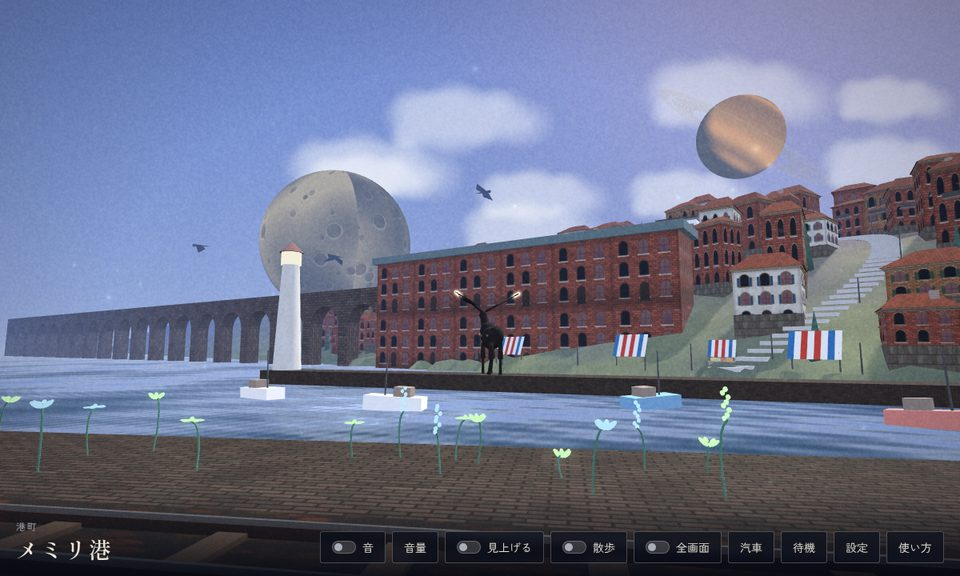
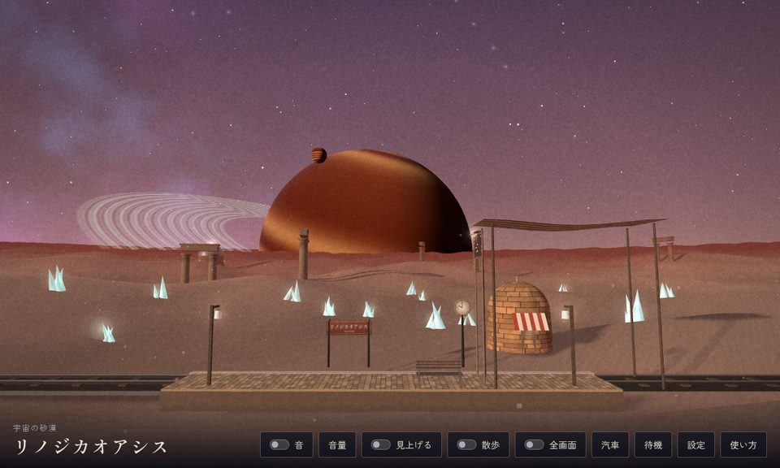
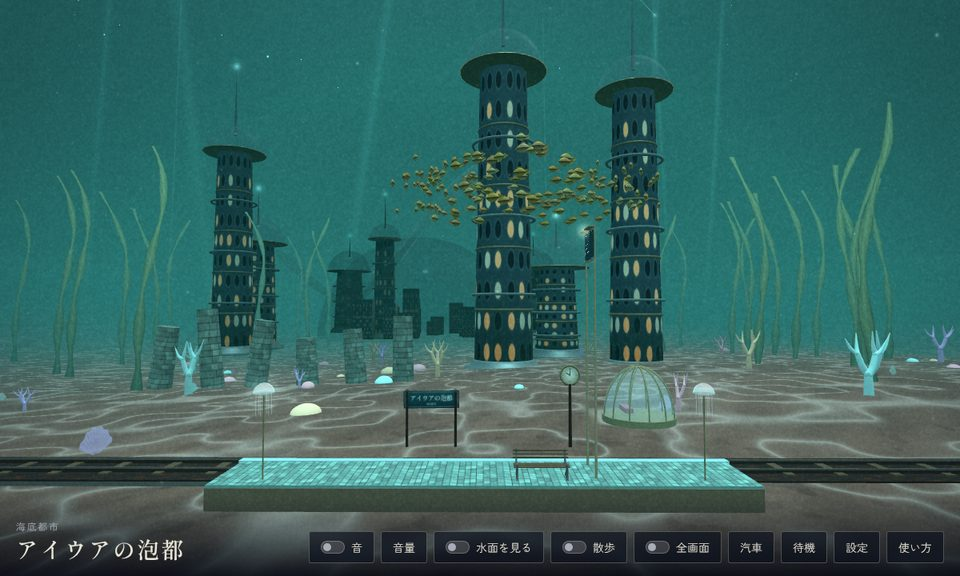
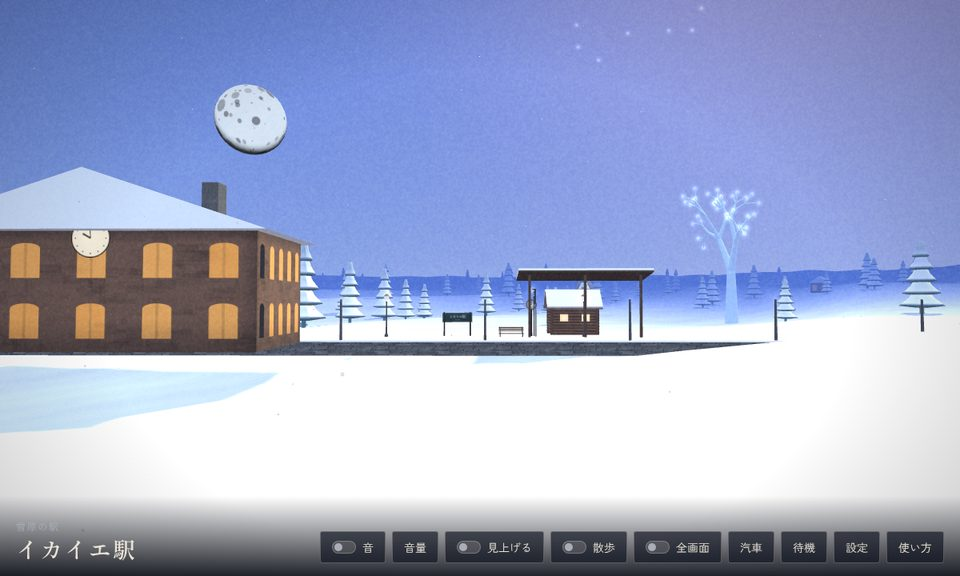
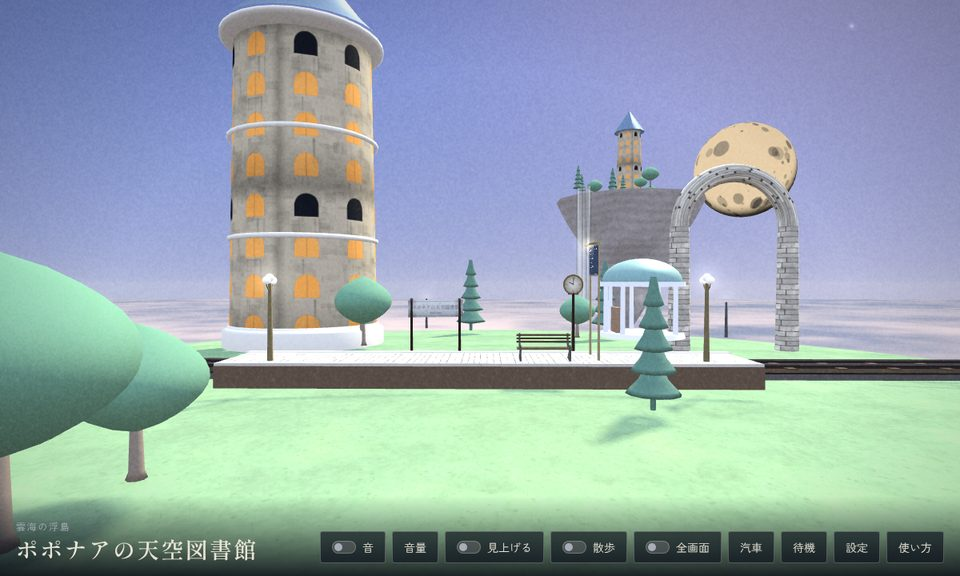
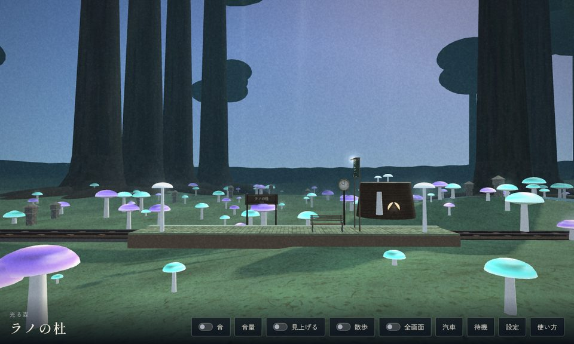
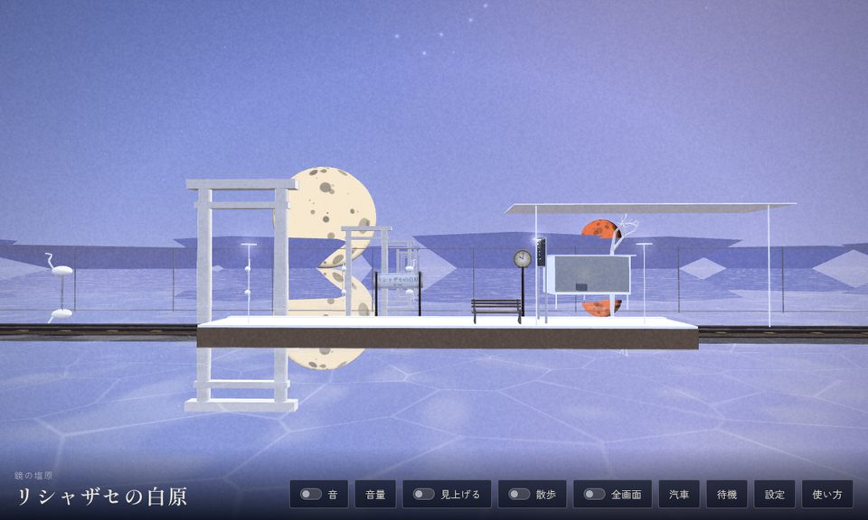
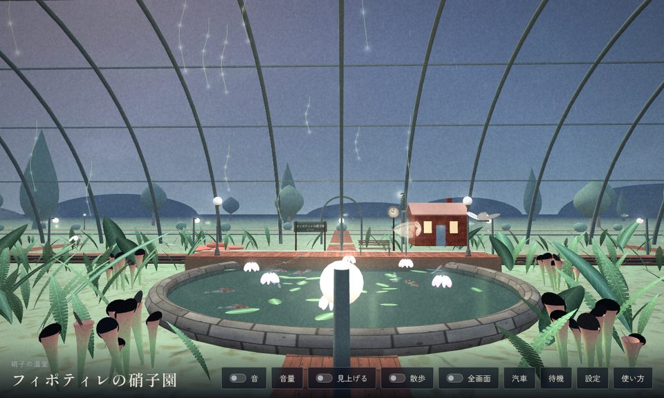

# まぼろし線

一本の線路でつながる8つの架空の世界を、汽車で旅して眺めるブラウザの3D景色です。
端末の時刻に合わせて朝・昼・夕・夜が移り、世界ごとの音楽が流れ、数十秒おきに小さな出来事が起きます。
部屋に飾る額縁や、作業中の環境音として使うことを想定しています。

| 港町 メミリ港 | 宇宙の砂漠 リノジカオアシス | 海底都市 アイウアの泡都 | 雪原の駅 イカイエ駅 |
| --- | --- | --- | --- |
|  |  |  |  |

| 雲海の浮島 ポポナアの天空図書館 | 光る森 ラノの杜 | 鏡の塩原 リシャザセの白原 | 硝子の温室 フィポティレの硝子園 |
| --- | --- | --- | --- |
|  |  |  |  |

## できること

- **汽車の旅**: 駅・線路・汽車に触れるとホームへ歩き、切符を一枚選ぶ。汽笛のあと汽車が正面から来て止まり、客車に乗る。車窓を世界と世界のあいだの景色が流れ、次の駅に着く。乗らずに「見送る」こともできる
- **歩く**: マウスのホイール、矢印キー／WASD、右下の円（スマホも同じ）。見えている場所をダブルタップするとそこまで歩く。「散歩」をオンにすると見どころを巡って自動で歩く
- **見る・触れる**: ドラッグで見回す。灯り・建物・生き物・水面・地面に触れると音と光で応える。長押しで光の輪が残る。空を見上げて上下になぞると時刻が動き、星座に触れると名前が浮かぶ
- **出来事**: 流星群、通り雨、吹雪、頭上を通る大きな生き物、鐘、蝶の群れ、開く花など、世界ごとに数種類
- **音**: 世界ごとに音階・音色・環境音が変わる自動演奏。汽笛、走行の音、到着と発車の音
- **待機**: 額縁（映し続ける）／ちらっと見る（電力を抑える）／音だけ。待機中に汽車で世界をめぐらせることもできる
- **時計**: 右上に小さな時計。押すと時刻と日付

## 動かし方

`index.html` をブラウザで開くだけで動きます。ビルドは要りません。

```
npx serve .
```

- three.js 0.170 と書体を CDN（jsDelivr・Google Fonts）から読み込むので、通信が必要です
- WebGL2 が使えるブラウザが必要です（今の iPhone / Android / Mac / Windows の主要ブラウザ）
- ホーム画面への追加や、画面を閉じたあとの音の再生を確実にするには、HTTPS で配信してください（Vercel、GitHub Pages など）
- Chrome 157 以降（パソコン）では、駅の発車標をじかに押して行き先を選べます（HTML-in-Canvas）。ほかの環境では手元の切符で選びます

## 端末ごとの開き方

| 端末 | おすすめ |
| --- | --- |
| iPhone / iPad | Safari で開き、共有 →「ホーム画面に追加」。全画面で開けます |
| Android | Chrome で開き、メニュー →「ホーム画面に追加」 |
| Mac / Windows | ブラウザで開き、「待機」→「額縁」で全画面 |

## 保存されるもの

端末の中（ブラウザの保存領域）にだけ、設定・光の輪・育つ木の記録を残します。サーバーには何も送りません。

## 作りについて

詳しいしくみは [ARCHITECTURE.md](ARCHITECTURE.md)、見た目のきまりは [DESIGN.md](DESIGN.md) にまとめています。

- 1つの HTML ファイルに、景色・音・操作のすべてが入っています。街や生き物の形と模様はすべてコードで作っていて、画像や3Dモデルのファイルは使っていません
- 線路の上には物を置かず、地形も線路より下に削ります
- 描画が重い端末では、自動で影を切って軽くします（設定の「描画」で戻せます）

## 作者

[BoxPistols](https://github.com/BoxPistols)

## ライセンス

MIT
